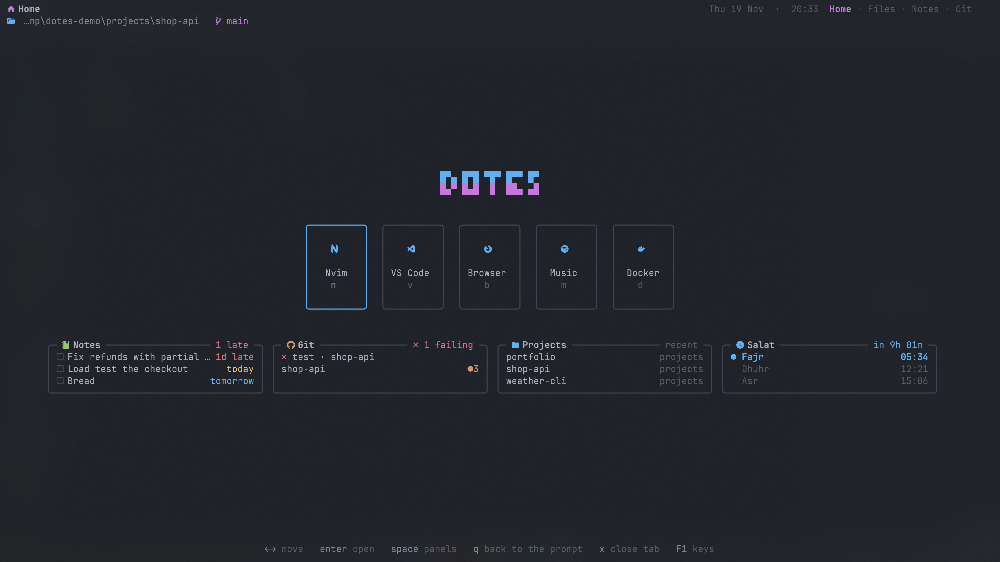
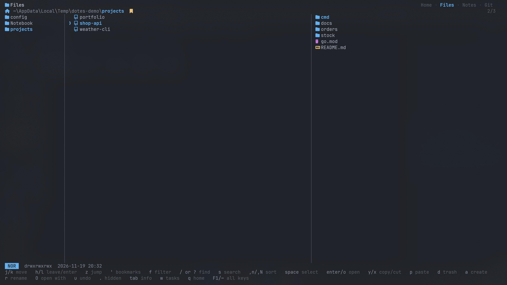
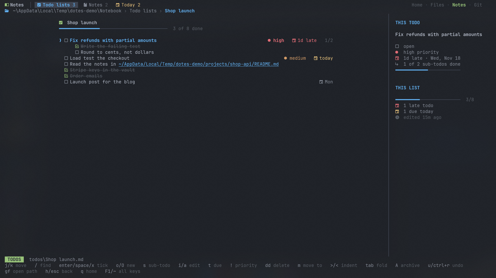
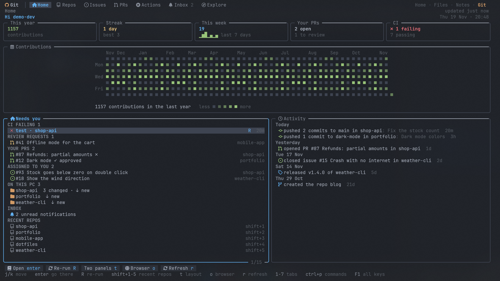
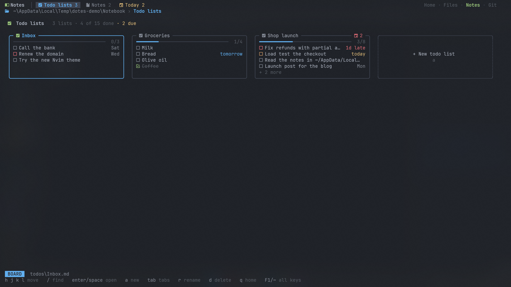
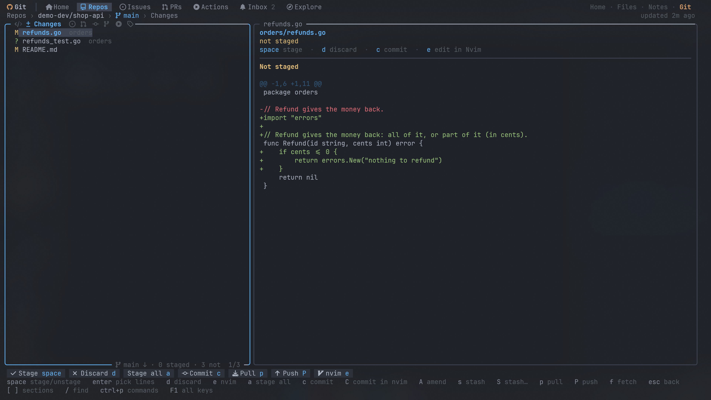

<div align="center">

# Dotes

**One terminal app for your day: your apps, your files, your todos and your GitHub.**
Pick the parts you want; they look the same, share their keys and link to each other.

[](https://github.com/Tahaldr/Dotes/releases/latest)
[](https://github.com/Tahaldr/Dotes/actions/workflows/test.yml)

[](LICENSE)



[Install](#install) · [The parts](#the-parts) · [Keys](#keys) · [Settings](#settings) · [FAQ](#faq)

</div>

---

## Install

**Windows** (PowerShell):

```powershell
irm https://raw.githubusercontent.com/Tahaldr/Dotes/master/install.ps1 | iex
```

**macOS / Linux:**

```sh
curl -fsSL https://raw.githubusercontent.com/Tahaldr/Dotes/master/install.sh | sh
```

The installer puts `dotes` in `~/.local/bin`, asks **which parts you want**, and offers to add a
small [shell function](#the-shell-function) to your profile. Then open a new terminal and type:

```sh
dotes
```

<details>
<summary><b>What you need</b> (click)</summary>

| | Why | |
|---|---|---|
| A [Nerd Font](https://www.nerdfonts.com) in your terminal | the icons | needed |
| [GitHub CLI](https://cli.github.com) (`gh`) | the Git part logs in with it (`dotes g login`) | for Git |
| `git` | changes, commits, branches on your PC | for Git |
| [fd](https://github.com/sharkdp/fd), [ripgrep](https://github.com/BurntSushi/ripgrep), [fzf](https://github.com/junegunn/fzf), [zoxide](https://github.com/ajeetdsouza/zoxide) | fast search and jumps in Files, recent projects on Home | nice to have |
| [7-Zip](https://www.7-zip.org) | `.7z` / `.rar` in Files (zip works without it) | nice to have |
| An editor (`nvim` by default) | opening files and notes | nice to have |

Windows Terminal, WezTerm, Kitty, Ghostty and iTerm2 all work.
</details>

---

## The parts

Every part has the **same first line**: its name and tabs on the left, and
`Home · Files · Notes · Git` on the right. Click a name or press `alt+1`…`alt+4` to switch;
`q` takes you back to Home. Each part has its own color, so you always know where you are.

<table>
<tr><td width="50%">

### 🏠 Home
Your apps as cards (up to 5 a row) and a **glance at everything else**:
what's due in Notes, repos with work to commit or push, failing CI, your recent projects
and the next prayer times.

`←→` pick an app · `enter` open · `space` jump to the panels

</td><td>


</td></tr>
<tr><td>

### 📁 Files
A [yazi](https://github.com/sxyazi/yazi)-style file manager: three columns, previews
(code, Markdown, images, archives), tabs, bookmarks, fuzzy jumps, git marks, the
Recycle Bin, bulk rename in your editor, and undo. `F` reads a file full screen (csv and Excel as a grid with sheets); drag the
lines between the columns to resize them.

`hjkl` move · `/` find · `z` jump · `space` select · `y` `x` `p` copy, cut, paste

</td><td>



</td></tr>
<tr><td>

### 📝 Notes
Todo lists and notes, as plain Markdown files you own. Due dates, priorities, sub-todos,
a **Today** tab, and **paths that become links**: type `~/` in a todo and pick a file.

`o` new todo · `x` tick · `t` due date · `!` priority · `gf` open a path

</td><td>



</td></tr>
<tr><td>

### 🐙 Git
GitHub and git in one place: your repos, **changes to stage line by line**, commits,
branches, PRs with reviews, issues, CI runs and logs, notifications and a contribution graph.

`space` stage · `c` commit · `P` push · `ctrl+p` every command

</td><td>



</td></tr>
</table>

### Live and linked

- **Live:** save a file in Nvim, commit in another terminal, tick a todo in another window:
  Dotes shows it at once. No refresh key.
- **Linked:**

  | From | Key | Goes to |
  |---|---|---|
  | Files | `gi` | this repo in **Git** |
  | Files | `gn` | this project's note in **Notes** |
  | Git | `ctrl+f` | the repo folder (or the highlighted file) in **Files** |
  | Notes | `gf` / click | the path in the todo, in **Files** |
  | Home | `space`, `enter` | a repo in **Git**, a project in **Files**, your todos in **Notes** |




---

## Commands

```text
dotes                  Home (or your first part)
dotes f [folder]       Files            dotes n             Notes
dotes g [tab|repo|.]   Git              dotes h projects    pick a project and open it

dotes n add "buy milk" -d fri -p high   add a todo from the prompt
dotes n today                           what's late and due today
dotes h salat                           today's prayer times
dotes h quick                           a one-line app picker under your prompt

dotes setup     pick your parts          dotes config    open the settings
dotes update    get the newest version   dotes --version
dotes --help    everything
```

---

## Keys

`F1` shows every key of the part you're in. The ones that work everywhere:

| Key | Does |
|---|---|
| `alt+1` … `alt+4` | switch part (or click its name on the first line) |
| `q` | back to Home (from a part you opened at the prompt, like `dotes f`: quit) |
| `F1` | all keys of this part |
| `j` `k` / arrows | move |
| `/` | find |
| `ctrl+p` | every command (Git) |

<details>
<summary><b>Home keys</b></summary>

| Key | Does |
|---|---|
| `←→` `↑↓` / `tab` | pick an app |
| `enter` / its letter | open it |
| `space` (or `↓` past the last row) | to the panels; `tab` next panel, `↑↓` a line, `enter` open it |
| `c` on the Notes panel | which todo list it shows (or what's due from all of them) |
| `q` | back to the prompt |
| `x` | close the terminal tab |
</details>

<details>
<summary><b>Files keys</b> (the most used)</summary>

| Key | Does |
|---|---|
| `h` `l` | parent folder / open |
| `gg` `G` | top / bottom |
| `z` / `Z` | jump with fzf / zoxide |
| `g` `space` | type a path: suggestions as you type, `tab` completes, `↑↓` picks |
| `b` / `'` | bookmark / bookmarks |
| `f` `/` `s` `S` | filter, find, search names, search text |
| `ctrl+s` | stop a search, or show its results if it finished while you browsed |
| `space` `v` | select, visual select |
| `y` `x` `p` `d` | copy, cut, paste, trash (`u` undoes) |
| `a` `r` | create, rename |
| `tt` `1`-`9` | new tab, go to tab |
| `gi` `gn` | open in Git, project note in Notes |
| `F` | read the file full screen; csv and Excel open as a grid: `tab` sheets, `/` find, `f` filter, `s` sort, `y` copy, `x` save as csv |
| `E` | show it in Explorer |
| drag a `│` | resize the columns (`=` puts them back) |
</details>

<details>
<summary><b>Notes keys</b> (the most used)</summary>

| Key | Does |
|---|---|
| `1` `2` `3` | Todo lists, Notes, Today |
| `o` `O` `s` | new todo below, above, sub-todo |
| `x` / `space` | tick |
| `i` `a` | edit the text |
| `t` `!` | due date, priority |
| `dd` `yy` `p` | cut, copy, paste a todo |
| `gf` | open the path in Files |
</details>

<details>
<summary><b>Git keys</b> (the most used)</summary>

| Key | Does |
|---|---|
| `1`-`7` | Home, Repos, Issues, PRs, Actions, Inbox, Explore |
| `enter` | open the repo / item |
| `[` `]` | sections in a repo: Code, Changes, Issues, PRs, Commits, Branches, Actions, Releases |
| `space` `enter` | stage a file / pick its lines |
| `c` `P` `p` | commit, push, pull |
| `e` `L` | open in your editor / lazygit |
| `ctrl+f` | the folder in Files |
| `ctrl+p` | every command |
</details>

---

## Settings

One folder: `%APPDATA%\dotes\` on Windows, `~/.config/dotes/` elsewhere
(`dotes config` opens it). Every option is explained in its file, and updates never touch them.

| File | What's in it |
|---|---|
| `dotes.txt` | your parts, key hints on/off, the part names on the first line |
| `home.txt` | your apps, the logo, prayer times, project folders, colors |
| `files.txt` | Files: hidden files, sorting, openers, previews (`files-bookmarks.txt`: bookmarks) |
| `notes.txt` | Notes: the notebook folder, editor, inbox list |
| `git.txt` | Git: start tab, where to clone, folders with your repos, editor, git tool |

<details>
<summary><b>Add your own app to Home</b></summary>

In `home.txt`, one line per app: name, hint, key, icon ([Nerd Font](https://www.nerdfonts.com/cheat-sheet) code), command.

```ini
app = Nvim    | editor  | n | f36f  | nvim .
app = VS Code | code    | v | f0a1e | code .
app = Shell   | prompt  | s |       |
```

An empty command goes back to the prompt; `projects` opens the project picker.
</details>

<details>
<summary><b>Prayer times</b></summary>

```ini
prayer = Casablanca | Morocco | 21
```

City, country and a [calculation method](https://aladhan.com/calculation-methods)
(21 = Morocco). Casablanca is the default; change it to your city, or leave it empty (`prayer =`) to turn prayer times off. The month is downloaded once and kept, so Home never waits. A prayer that just came in shows "since" instead of "in" for 15 minutes (Maghrib 10), the time until the iqama.
</details>

<details>
<summary><b>Where your notes are</b></summary>

Plain Markdown files in `~/Documents/Notebook` (change `notebook =` in `notes.txt`):

```text
Notebook/
  todos/   one file per todo list
  notes/   one file per note
```

Edit them anywhere; Dotes picks up the change at once.
</details>

### The shell function

With it, quitting Files (opened with `dotes f`) leaves your shell in that folder, opening a
project goes there, and `x` on Home closes the tab. The installer adds it, or add the line:

```powershell
# PowerShell: $PROFILE   (--start also opens Home in every new tab)
dotes.exe shell pwsh --start | Out-String | Invoke-Expression
```

```sh
# bash / zsh: ~/.bashrc or ~/.zshrc
eval "$(command dotes shell bash --start)"
```

---

## FAQ

<details>
<summary><b>Do I have to install every part?</b></summary>

No. Pick them at install (or later with `dotes setup`); the others stay out of sight.
</details>

<details>
<summary><b>How do I update?</b></summary>

`dotes update`. The first line shows `⬆ new version` when there is one.
</details>

<details>
<summary><b>The icons are boxes / question marks</b></summary>

Your terminal needs a [Nerd Font](https://www.nerdfonts.com), e.g. CaskaydiaCove Nerd Font.
</details>

<details>
<summary><b>Git says I'm not logged in</b></summary>

Install the [GitHub CLI](https://cli.github.com), then run `dotes g login`. `dotes g doctor` checks the rest.
</details>

<details>
<summary><b>Arabic text looks broken</b></summary>

Dotes lays Arabic out itself (Windows Terminal can't); use a font with Arabic, e.g. a Nerd Font patched Cascadia.
</details>

---

## Build

```sh
go test ./...
go build -o dotes .
```


MIT license.
